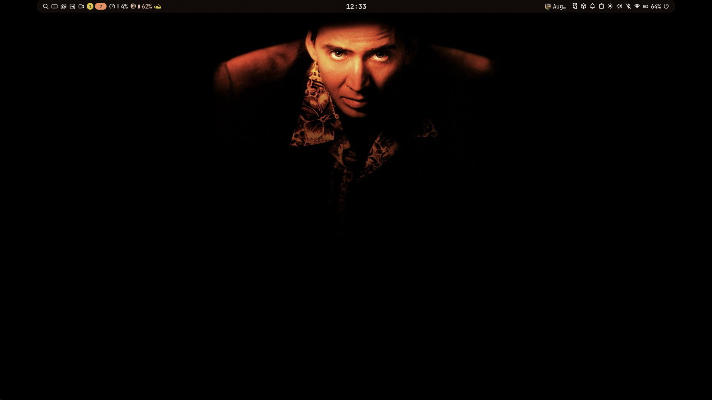
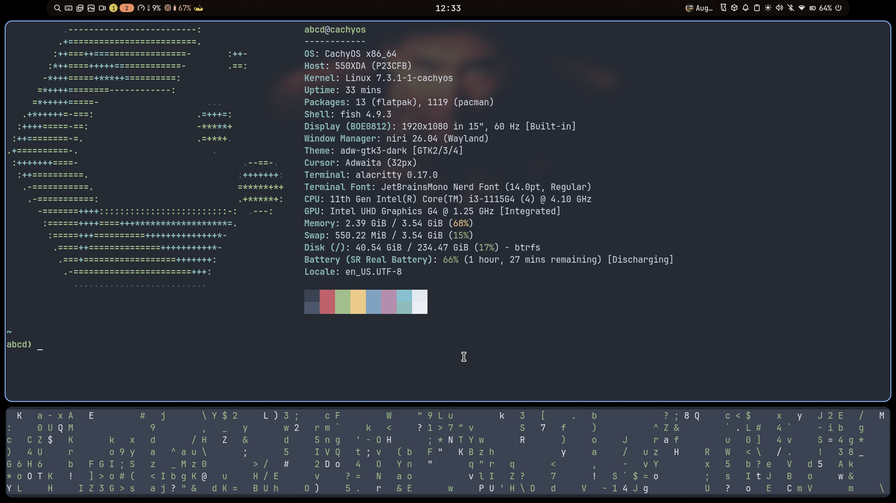

# cachyos-niri-dotfiles

Meus dotfiles do **CachyOS** com **niri** e **Noctalia**, num notebook com i3-1115G4 e 4 GB de RAM.




## O que tem aqui

- **niri**: compositor com tiling em rolagem
- **Noctalia**: shell (barra, launcher, notificações, wallpaper)
- **Umbriel**: compositor alternativo, em teste
- **Alacritty e kitty**: terminais
- **fish + Starship**: shell e prompt
- **fastfetch**: informações do sistema
- **greetd**: tela de login (Noctalia Greeter)
- **wallpapers/**: meus wallpapers
- **pkglist.txt e aur-pkglist.txt**: pacotes instalados

## Instalação

As listas de pacotes são do **CachyOS**. Pelos nomes (`cachyos-*`, `linux-cachyos`), não funcionam direto no Arch puro.

```
sudo pacman -S --needed - < pkglist.txt
yay -S --needed - < aur-pkglist.txt
```

Depois, copia a pasta `.config/` pra home e ajusta o caminho dos wallpapers no Noctalia (`/home/abcd/Pictures/wallpapers` é da minha máquina).
